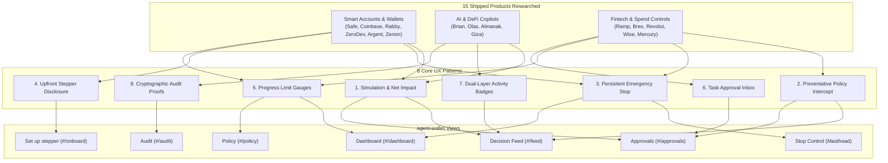

# UI/UX Research: agent-wallet Webapp

Research date: 2026-10-15  
Status: Reference research document for webapp UI/UX design and implementation  
Scope: Plain HTML/CSS/JS implementation using `DESIGN.md` tokens (zero new dependencies)

---

## 1. Summary: 8 Ranked Patterns Most Worth Copying

The following table summarizes the eight user experience patterns identified across industry-leading products that best address the design challenges of `agent-wallet`. Each pattern is ranked by its impact on user trust, safety, and operational clarity.

| Rank | Pattern | Source Products | Target View in `agent-wallet` | Primary UX Value |
| :---: | :--- | :--- | :--- | :--- |
| **1** | **Pre-Execution Simulation & Net Balance Impact Cards** | Rabby, Brian, Almanak | **Feed** & **Approvals** | Eliminates blind signing; shows exact tokens entering, leaving, and estimated gas before any approval. |
| **2** | **Preventative Plain-Language Policy Interceptions** | Ramp, Brex | **Feed** & **Approvals** | Explains blocked or queued actions in a single plain sentence; system rule codes are kept as secondary metadata chips. |
| **3** | **One-Tap Persistent Emergency Stop with Visual State Shift** | Revolut, Ramp, Argent | **Stop control** (Masthead) & **Dashboard** | Provides an instant, irreversible-until-signed emergency brake with dramatic visual state feedback (polar shift / warning chip). |
| **4** | **Upfront Stepper with Explicit Wallet Interaction Disclosure** | Coinbase Smart Wallet, ZeroDev, Wise | **Set up stepper** (`#/onboard`) | Removes Web3 onboarding anxiety by stating before the user clicks whether an action requires a signature, gas, or is server-side. |
| **5** | **Visual Progress Limit Gauges with Reset Timing** | Safe, Revolut, Mercury | **Dashboard** & **Policy** | Displays daily spend consumption as an intuitive fraction (`$45 / $100 spent today`) with explicit reset schedule notice. |
| **6** | **Task-Driven Approval Inbox with Step-Up Context** | Wise, Brex, Argent | **Approvals** (`#/approvals`) | Organizes pending actions into a discrete queue with explicit "Approve" (triggering step-up signature) and "Reject" actions. |
| **7** | **Dual-Layer Activity Badging (Agent Reason vs. On-Chain Execution)** | Olas, Brian, Zerion | **Feed** (`#/feed`) | Clearly differentiates planner reasoning ("Live LLM", "Scripted Demo", "Fallback") from confirmed BaseScan transaction receipts. |
| **8** | **Cryptographic Chain Verification & Audit Trust Badges** | Giza, Safe, Mercury | **Audit** (`#/audit`) | Offers one-click in-browser and server verification of the hash-chained audit log with plain-language integrity verdicts. |

---

## 2. Per-Product Notes

### Category (a): Smart Accounts, Session Keys & Modern Web3 Wallets

#### 1. Safe (formerly Gnosis Safe)
- **URL**: `https://safe.global`
- **What it does**: Multi-signature smart contract account platform for institutional and team treasury management.
- **Onboarding flow**: Stepper creating or connecting a smart account; explicitly separates owner key configuration from module additions.
- **Delegation & limits display**: Allowance Module shows a "Spending Limits" table with beneficiary address/ENS, token, remaining allowance ratio (e.g., "$450 / $1,000"), and reset cadence (daily/monthly).
- **Blocked or pending actions**: Queue view indicates missing signatures required to reach threshold; highlights expired or exhausted spending allowances.
- **Activity feed design**: Segregates standard multi-sig executed transactions from delegate-executed "Module Transactions".
- **Balances & allocation**: Aggregated fiat and token balances with asset distribution list and token icons.
- **Trust & safety cues**: Displays multi-sig threshold requirements (e.g., "2 of 3"), contract audit badges, and direct block explorer links.
- **Empty & error states**: Explicit empty state encouraging allowance creation; failed executions describe contract revert reasons.
- **Mobile behaviour**: Responsive web application; mobile browser supports full transaction review and wallet connection.

#### 2. Coinbase Smart Wallet & AgentKit
- **URL**: `https://smart-wallet.xyz` | `https://coinbase.com/developer-platform/products/agentkit`
- **What it does**: Passkey-native ERC-4337 smart wallet with on-chain Spend Permissions and autonomous AI AgentKit integrations.
- **Onboarding flow**: Frictionless passkey creation (FaceID/TouchID/Windows Hello); zero seed phrase prompt; sub-account provisioning.
- **Delegation & limits display**: Spend Permissions manager presents a human-readable allowance card: spender address/app, recurring spend cap (e.g., "10 USDC per month"), and validity window.
- **Blocked or pending actions**: Background execution fails closed if spend exceeds granted allowance; prompts owner for passkey re-authorization.
- **Activity feed design**: Clean transaction feed itemizing automated app transactions under sub-account activity tabs.
- **Balances & allocation**: Unified asset summary; isolates main account funds from scoped sub-account balances.
- **Trust & safety cues**: Clear separation between master passkey authority and delegated session allowances; testnet network chip in sandbox environments.
- **Empty & error states**: Simple card empty states with single CTA ("Grant Spend Permission"); passkey cancellation clearly reported without scary error banners.
- **Mobile behaviour**: Native-like mobile browser performance utilizing platform WebAuthn authenticators.

#### 3. Rabby Wallet
- **URL**: `https://rabby.io`
- **What it does**: Open-source browser extension and mobile wallet engineered specifically for DeFi security and transaction simulation.
- **Onboarding flow**: Standard seed/private key import or hardware/smart account pairing with quick whitelist configuration.
- **Delegation & limits display**: Built-in "Approvals" dashboard itemizing all open token allowances categorized by risk exposure (e.g., Unlimited vs. Capped).
- **Blocked or pending actions**: Pre-execution security engine intercepts transactions before signing; displays high-contrast warning badges (e.g., "Spender contract deployed < 3 days ago", "Recipient not in whitelist").
- **Activity feed design**: Chronological feed translating calldata into clear verbs (*Swap*, *Send*, *Approve*).
- **Balances & allocation**: Multi-chain balance aggregator with net balance change breakdown per asset.
- **Trust & safety cues**: Pre-sign transaction simulation panel explicitly displaying "Net Balance Change" (tokens out vs. tokens in) and gas cost in fiat.
- **Empty & error states**: Meaningful empty states ("No approvals detected"); transaction failure simulations show estimated gas failure before broadcast.
- **Mobile behaviour**: Mobile app mirrors extension security rules with full simulation view on sheet popups.

#### 4. ZeroDev
- **URL**: `https://zerodev.app`
- **What it does**: Modular ERC-4337 smart account infrastructure featuring granular session keys and policy enforcement.
- **Onboarding flow**: Developer-focused SDK with demo console; creates Kernel smart accounts backed by passkeys or social logins.
- **Delegation & limits display**: Scoped session keys defined by tripartite policies: Signer (who), Policy (when/limits: timestamp expiry, spend caps, target contract whitelists), and Action (allowed functions).
- **Blocked or pending actions**: Transactions breaching session policies are rejected client-side or at the paymaster/bundler validation phase with explicit constraint violation codes.
- **Activity feed design**: UserOp execution logs showing bundler hash, paymaster sponsorship status, and decoded call arguments.
- **Balances & allocation**: Smart account balance cards with gas sponsorship indicator (*Gasless* badge).
- **Trust & safety cues**: Testnet deployment toggles; paymaster gas sponsorship policy indicators; explicit session expiry countdowns.
- **Empty & error states**: Code snippet fallback when no session keys are active; simulation error reporting for invalid session signatures.
- **Mobile behaviour**: SDK components adapt cleanly to mobile viewports with biometric prompt triggers.

#### 5. Argent
- **URL**: `https://argent.xyz`
- **What it does**: Smart contract wallet on Ethereum and Starknet featuring Guardians, daily limits, and account recovery.
- **Onboarding flow**: Phone/email authentication creating a smart account; guided Guardian assignment flow.
- **Delegation & limits display**: Prominent "Daily Transfer Limit" indicator (e.g., "$1,000/day"); shows consumed limit vs. remaining allowance.
- **Blocked or pending actions**: Transactions exceeding the daily limit are not outright rejected; they trigger a 24-hour timelock delay, bypassable via majority Guardian approval.
- **Activity feed design**: Clean transaction cards with clear status pills (*Pending*, *Delayed*, *Approved*, *Executed*).
- **Balances & allocation**: Portfolio balance breakdown by asset and DeFi investment protocol.
- **Trust & safety cues**: Dedicated "Security" tab showing Guardian status, active session timers, and a one-tap "Lock Wallet" emergency switch.
- **Empty & error states**: Friendly illustrations for zero balance; clear instructions when a Guardian approval request is waiting.
- **Mobile behaviour**: Mobile-first architecture with native push notifications for over-the-limit attempts.

#### 6. Zerion
- **URL**: `https://zerion.io`
- **What it does**: Smart Web3 wallet and DeFi portfolio tracker across EVM networks.
- **Onboarding flow**: Instant read-only tracking via ENS/address or wallet generation/connection.
- **Delegation & limits display**: Token approval manager displaying total exposed value and direct revoke buttons.
- **Blocked or pending actions**: Pending transactions show animated spinner with estimated speed-up/cancel options.
- **Activity feed design**: Benchmark feed: parses raw calldata into human verbs (*Supply USDC on Aave*, *Borrow*, *Swap*); displays protocol icons, net value shift, and gas in fiat.
- **Balances & allocation**: Asset allocation donut chart and bar; balances segmented by Wallet, Staking, and Liquidity Pools.
- **Trust & safety cues**: Mainnet/testnet network chips; integrated security evaluation on token contracts; verified protocol badges.
- **Empty & error states**: Explanatory empty states for new wallets ("Deposit crypto to get started"); clear RPC outage warnings.
- **Mobile behaviour**: Outstanding responsive design and native mobile app with gesture-based navigation.

---

### Category (b): AI Trading & DeFi Copilots

#### 7. Brian (Brian Knows)
- **URL**: `https://brianknows.org` *(Developer repositories: `github.com/brian-knows`)*
- **What it does**: Intent-based AI assistant translating natural language prompts into executable Web3 transactions.
- **Onboarding flow**: Connect Web3 wallet (MetaMask, WalletConnect); direct prompt input interface without lengthy onboarding steps.
- **Delegation & limits display**: Non-custodial model: model proposes multi-step execution plans (e.g., Step 1: Approve, Step 2: Swap) which the user must explicitly inspect and sign.
- **Blocked or pending actions**: If prompt violates input constraints or liquidity pools lack depth, conversational response details the breakdown in plain English.
- **Activity feed design**: Conversational thread interspersed with transaction preview cards and BaseScan explorer links.
- **Balances & allocation**: Contextual balance lookup queried via natural language ("What is my USDC balance on Base?").
- **Trust & safety cues**: Explicit prompt confirmation cards; step-by-step transaction preview; citations of protocol docs for knowledge queries.
- **Empty & error states**: Suggested prompts on blank state ("Swap 10 USDC to ETH on Base", "Deposit to Aave"); graceful recovery when LLM fails to parse intent.
- **Mobile behaviour**: Responsive chat interface suited for mobile screens with touch-friendly action cards.

#### 8. Olas (Autonolas) & agents.fun
- **URL**: `https://olas.network` | `https://operate.olas.network`
- **What it does**: Autonomous off-chain service infrastructure where AI agents operate on-chain via smart contracts and staking mechanisms.
- **Onboarding flow**: Operator dashboard connects wallet; prompts operator to stake OLAS tokens into an autonomous agent service instance.
- **Delegation & limits display**: Staking threshold indicators and service multisig configurations detailing agent operating boundaries.
- **Blocked or pending actions**: Agent service failures or slashing warnings flagged in red; degraded service alerts when RPC endpoints stall.
- **Activity feed design**: Dual-layer event feed: separates off-chain agent computation cycles (rounds, state transitions) from on-chain multisig settlement transactions.
- **Balances & allocation**: Agent operational balance (gas ETH) vs. staked bond assets displayed in distinct stat panels.
- **Trust & safety cues**: Operator pause/terminate controls; on-chain service registry contracts; public staking contracts.
- **Empty & error states**: Step-by-step guidance for unfunded agent instances; detailed error logs in expandable inspection drawer.
- **Mobile behaviour**: Functional on desktop; mobile view is legible for monitoring but operations are desktop-optimized *(unverified on small mobile viewports)*.

#### 9. Almanak
- **URL**: `https://almanak.co`
- **What it does**: Agentic DeFi platform running quantitative trading and risk management strategies via scoped Safe smart accounts.
- **Onboarding flow**: Strategy builder interface pairing institutional accounts with strategy sandboxes.
- **Delegation & limits display**: Visual risk guardrails: maximum draw-down limits, per-trade slippage boundaries, and leverage caps.
- **Blocked or pending actions**: Pre-execution simulation against live mainnet forks (Anvil/Foundry) catches policy breaches before on-chain dispatch.
- **Activity feed design**: Strategy log detailing backtest performance, paper-trading outcomes, and live execution events with PnL telemetry.
- **Balances & allocation**: Quantitative allocation breakdown showing position delta, collateralization ratios, and stablecoin reserves.
- **Trust & safety cues**: Non-custodial execution through Safe smart accounts; backtesting audit reports; parameter bounding.
- **Empty & error states**: Template strategies provided for zero-state onboarding; simulation failure traces displayed in analytical cards.
- **Mobile behaviour**: Desktop analytics dashboard; mobile is read-only orientation *(unverified for active trading controls)*.

#### 10. Giza
- **URL**: `https://giza.xyz`
- **What it does**: Verifiable machine learning infrastructure enabling autonomous AI agents to execute on-chain backed by Zero-Knowledge (ZK) proofs.
- **Onboarding flow**: Developer-centric CLI/SDK onboarding connecting Web3 endpoints to verifiable inference models.
- **Delegation & limits display**: Agent policies governed by mathematical proof parameters rather than arbitrary off-chain heuristics.
- **Blocked or pending actions**: Invalid model inferences or out-of-bound inputs fail cryptographic proof generation, preventing contract execution.
- **Activity feed design**: Execution logs showing proof verification status, settlement transactions, and inference latency.
- **Balances & allocation**: Agent gas balance and target vault TVL metrics.
- **Trust & safety cues**: Cryptographic ZK-proof verification chips on-chain; auditable inference contracts; decentralized EigenLayer AVS integration.
- **Empty & error states**: CLI log stream output with clear proof-failure debugging information.
- **Mobile behaviour**: Developer dashboard with responsive tables *(mobile usage is unverified/uncommon)*.

---

### Category (c): Consumer Fintech & Spend Management Dashboards

#### 11. Ramp
- **URL**: `https://ramp.com`
- **What it does**: Corporate card and automated spend management platform with real-time policy enforcement and approvals.
- **Onboarding flow**: Guided identity verification, organization role configuration, and immediate issuance of virtual spend cards.
- **Delegation & limits display**: Explicit spend limits per card: transaction limit, daily/monthly limit, and category restrictions (e.g., software only).
- **Blocked or pending actions**: Hard decline at point of sale. Real-time push notification and in-app feed banner explaining *exactly* why: "Declined: Exceeds your $500 monthly software limit". Provides immediate inline "Request Exception" CTA.
- **Activity feed design**: Real-time transaction feed with high-contrast status chips (*Approved*, *Declined*, *Needs Receipt*); clicking opens full policy breakdown.
- **Balances & allocation**: Live budget consumption bar graphs showing spent vs. remaining allowance per department/card.
- **Trust & safety cues**: Instant "Freeze Card" toggle on every card surface; SOC 2 compliance notices; two-factor authentication on high-value actions.
- **Empty & error states**: Clean zero-state illustrations encouraging card creation; clear error recovery modal with pre-filled manager request forms.
- **Mobile behaviour**: Best-in-class mobile app with instant push alerts for declines and one-tap card freeze.

#### 12. Brex
- **URL**: `https://brex.com`
- **What it does**: Enterprise financial platform integrating corporate cards, expense policies, and multi-tier approval workflows.
- **Onboarding flow**: Enterprise onboarding with team hierarchy definition and automated budget assignment.
- **Delegation & limits display**: Preventative spend limits embedded into card details; visual progress rings indicating budget usage.
- **Blocked or pending actions**: Point-of-sale decline paired with plain-language explanation of violated rule (e.g., "Out of policy: Unapproved merchant category").
- **Activity feed design**: Unified feed grouping transactions by date, cardholder, and compliance status; inline receipt upload affordance.
- **Balances & allocation**: Real-time cash balance summary and department spend breakdown.
- **Trust & safety cues**: Hard spending limits (card declines) vs. soft limits (manager flagged); SOC 1/2 certifications; bank-grade encryption notices.
- **Empty & error states**: Friendly empty states with clear action pathways; visual toast notifications on policy errors.
- **Mobile behaviour**: Seamless feature parity between web and mobile; push notifications for manager approvals with inline "Approve/Deny".

#### 13. Revolut
- **URL**: `https://revolut.com`
- **What it does**: Global consumer and business financial super-app with multi-currency accounts, disposable virtual cards, and budgeting.
- **Onboarding flow**: Mobile phone verification, biometric setup, instant card provisioning within 60 seconds.
- **Delegation & limits display**: Granular card security settings: monthly spending limit slider, online transactions toggle, ATM withdrawal toggle.
- **Blocked or pending actions**: Immediate decline alert specifying reason: "Declined: Monthly card limit reached" or "Card is frozen".
- **Activity feed design**: Rich transaction feed with merchant branding, categorisation icons, timestamp, and net currency balance change.
- **Balances & allocation**: Prominent multi-currency carousel showing individual fiat and crypto pocket balances with percentage changes.
- **Trust & safety cues**: One-tap "Freeze" button with instant haptic and visual feedback (card image turns frosted-ice blue with a padlock icon); regulatory license disclosures in footer.
- **Empty & error states**: Cheerful empty states ("Your pocket is empty — add money to start spending"); helpful inline retry links on failed bank transfers.
- **Mobile behaviour**: Mobile-first native application with industry-leading micro-interactions, dark mode, and biometric lock.

#### 14. Wise (formerly TransferWise)
- **URL**: `https://wise.com`
- **What it does**: International money transfer service and multi-currency business account with transparent fees and payment approvals.
- **Onboarding flow**: Step-by-step transfer calculator showing exact exchange rates, transparent fees, and delivery estimate before account sign-up.
- **Delegation & limits display**: Business team permissions with approval thresholds: transactions above $X require approval from 1 or 2 authorized approvers.
- **Blocked or pending actions**: Pending transfers placed into a prominent "Tasks" / "Needs Approval" dashboard banner with remaining expiration timer (e.g., "Expires in 5 days").
- **Activity feed design**: Clean chronological list with distinct transaction state chips (*Processing*, *Sent*, *Cancelled*); clicking opens an interactive timeline.
- **Balances & allocation**: Multi-currency jars displayed as distinct balance cards with real-time conversion shortcuts.
- **Trust & safety cues**: Radical fee transparency: fee breakdown itemized to the penny; live mid-market exchange rate guarantee; regulatory authorization badges.
- **Empty & error states**: Clear guidance when an account is unverified or awaiting bank deposit; helpful troubleshooting for failed bank debits.
- **Mobile behaviour**: Responsive web application and native mobile app with complete feature parity for approvals and transfers.

#### 15. Mercury
- **URL**: `https://mercury.com`
- **What it does**: Modern business banking and financial operations platform built for startups and technology companies.
- **Onboarding flow**: Polished web stepper for corporate formation documents and owner identity verification.
- **Delegation & limits display**: Role-based access controls and custom daily/monthly card spend limits shown directly on the user's card dashboard.
- **Blocked or pending actions**: Transactions crossing approval thresholds route to an "Approvals" inbox; preparer sees status "Awaiting approval from admin".
- **Activity feed design**: Elegant, data-dense ledger view with search, filter by team member, merchant, and accounting tags.
- **Balances & allocation**: Clean total balance display broken down by checking, savings, and Treasury (yield funds).
- **Trust & safety cues**: FDIC insurance partner badges ($5M coverage through sweep networks); SOC 2 compliance; transparent wire fee schedules.
- **Empty & error states**: Minimalist, warm empty states; informative error banners with link to support documentation.
- **Mobile behaviour**: Fast, clean mobile companion app allowing quick transaction review and instant wire approvals.

---

## 3. Adoption List for agent-wallet Frontend

The following table provides a prioritized, actionable list of frontend enhancements specifically tailored for `agent-wallet`. Every item is designed to be built using plain vanilla HTML/CSS/JavaScript and the tokens defined in `DESIGN.md`, requiring **zero new dependencies or build steps**.

| Item ID | Component / Area | Description | Implementation Details (Plain HTML/CSS/JS + `DESIGN.md`) | Size | Priority | Target View |
| :---: | :--- | :--- | :--- | :---: | :---: | :--- |
| **A-1** | **Stepper Prompt Disclosures** | Explain upfront what each onboarding step requires from the user's wallet before they click. | Add a descriptive `.note` below each step title: "Connects wallet & signs free login", "Sends test ETH tx (gas)", "Server mints test USDC (0 prompts)", "Signs policy preset confirmation". Matches Coinbase & Wise. | **S** | **High** | `#/onboard` |
| **A-2** | **Plain-Language Rule Intercepts** | Reformat blocked/denied/queued decision feed cards so the plain sentence is the headline, not the raw enum. | Render human explanation (from `explain.js`) as bold headline (`font-weight: 700`); relegate rule codes (`LIMIT.PER_TX`, `TIER.APPROVAL_REQUIRED`) to neutral chip metadata below. Matches Ramp & Brex. | **S** | **High** | `#/feed`, `#/approvals` |
| **A-3** | **High-Contrast Freeze State on Stop** | Visually flip the stop button and header bar into a prominent "FROZEN" state when emergency stop is active. | When `emergency_stop` is true, toggle masthead `.controls` and `#btn-stop` to warm gold/error chip (`--error` or `--accent-gold-soft`), with clear text: "EMERGENCY STOP ACTIVE · All orders blocked". Matches Revolut & Ramp. | **S** | **High** | Masthead / `#btn-stop` |
| **A-4** | **Daily Spend Progress Bar & Reset** | Transform raw spent vs. daily limit text into a visual ratio bar with reset schedule information. | Use an HTML `<progress>` or styled `div.spend-bar` (`background: var(--canvas-tint)` with `var(--primary)` fill) showing `$X / $Y USDC spent today`, with caption "Resets daily at 00:00 UTC". Matches Safe & Revolut. | **M** | **High** | `#/dashboard` |
| **A-5** | **Gas Floor Warning Indicator** | Provide explicit visual feedback on agent ETH gas balance relative to the required gas floor. | Display a status pill next to ETH balance: `✓ Above floor (0.002 ETH)` or `! Below gas floor` with inline link navigating directly to `#/onboard` step 2. Prevents failed run attempts. Matches Rabby. | **S** | **Medium** | `#/dashboard` |
| **A-6** | **Dual-Layer Planner Badging** | Clearly tag decision records with their planner provenance. | Render a distinct `.chip` on feed cards: `OpenAI Planner` (live model), `Offline Fallback` (deterministic rule engine), or `Scripted Demo` (fixed test fixture). Preserves strict honest framing. Matches Olas & Brian. | **S** | **Medium** | `#/feed` |
| **A-7** | **Dedicated Approvals Action Card** | Present pending orders in a structured inbox card with direct action buttons and parameter breakdowns. | Build pending order card showing amount, protocol, trigger rule (`TIER.APPROVAL_REQUIRED`), and paired `Approve (needs sign)` and `Reject` buttons. Step-up signature prompt is triggered cleanly. Matches Wise & Brex. | **M** | **Medium** | `#/approvals` |
| **A-8** | **Audit Hash Verification Verdict Banner** | Provide immediate, human-readable feedback when client/server audit chain verification is performed. | Replace plain text status with a structured card: `✓ Hash chain intact (N records verified)` in forest green (`var(--forest)`), or error highlighting the specific broken sequence number `seq`. Matches Giza & Mercury. | **S** | **Medium** | `#/audit` |
| **A-9** | **Actionable Empty States** | Upgrade empty lists to include contextual guidance and direct navigation links. | Replace "No decisions yet" with a card providing an explanatory paragraph and a primary CTA button: "Run agent now" or "Set up policy". Matches Zerion & Ramp. | **S** | **Low** | `#/dashboard`, `#/feed` |
| **A-10** | **Custody & Testnet Trust Banner Refinement** | Maintain static, non-dismissible banner communicating testnet status, server custody, and reference pricing. | Ensure banner persists across all views with high-contrast text on `var(--accent-gold-soft)`: "Testnet only (Base Sepolia) · Custodial server key · Mainnet reference prices". Matches fintech disclosure standards. | **S** | **Low** | Global (`index.html`) |

---

## 4. Anti-Patterns Seen and Risks to Avoid

Reviewing modern DeFi and fintech applications revealed numerous user experience antipatterns and deceptive practices that must be rigorously avoided in `agent-wallet`:

### 1. The Blind-Signing Trap (Crypto Anti-Pattern)
- **What it is**: Forcing users to approve unreadable hexadecimal bytecode, generic function selectors (`0x095ea7b3`), or vague permission grants without simulating or explaining the net balance impact.
- **Why we avoid it**: It is the single largest cause of Web3 user fund losses. `agent-wallet` completely avoids this by displaying deterministic plain-language explanations, exact token deltas, and human-readable parameters in `explain.js` before and after any execution.

### 2. Infinite Token Approvals by Default
- **What it is**: Requesting users to approve `type(uint256).max` (`1.1579...e+77`) allowances to save gas on subsequent transactions.
- **Why we avoid it**: Leaves user balances permanently exposed to smart contract exploit drainers. Our contract and gateway enforce exact per-transaction allowances and scoped policy caps.

### 3. Misleading APY / Yield Projections
- **What it is**: Advertising temporary promotional liquidity mining spikes (e.g., "Earn 45% APY!") in prominent bold text while hiding base market rates, protocol risks, and variable borrow fees in fine print.
- **Why we avoid it**: Erodes user trust and violates regulatory fintech honesty standards. `agent-wallet` labels all returns as live Aave V3 lending rates and explicitly discloses that testnet numbers utilize mainnet reference price feeds.

### 4. "Detective" Reactive Budgeting (The Post-Facto Surprise)
- **What it is**: Allowing an automated system or employee to execute transactions without boundary checks, then sending an angry alert or rejection report hours or days later.
- **Why we avoid it**: We follow the **preventative UX model** championed by Ramp and Brex: transactions exceeding the policy engine's parameters are denied *at the gateway before the signer is ever touched*, with immediate plain-language reasons logged to the immutable audit trail.

### 5. Concealed Fees and Obfuscated Gas Costs
- **What it is**: Quoting a "zero-fee" transaction while burying high slippage markups, opaque gas relayer spreads, or unstated protocol fees in the final execution.
- **Why we avoid it**: Complete fee honesty is required. Our top-up flow details the exact Base Sepolia gas floor in wei and ETH, explaining clearly that the agent cannot fund its own gas because public faucets require human CAPTCHAs.

### 6. Buried or Complicated Kill Switches
- **What it is**: Hiding the ability to revoke permissions, freeze cards, or stop automated agents deep inside nested account settings menus or behind customer support tickets.
- **Why we avoid it**: A credible safety product must provide immediate, high-priority emergency controls. The `Emergency stop` button is permanently anchored in our masthead across every view, disabling all operations in a single click.

### 7. Cryptic Raw Error Codes
- **What it is**: Presenting end users with stack traces or technical RPC strings such as `Execution reverted: 0x4e487b71`, `UNPREDICTABLE_GAS_LIMIT`, or `HTTP 500 Internal Server Error`.
- **Why we avoid it**: Unexplained technical errors induce panic. All errors in `agent-wallet` are mapped through `explainError()` into actionable guidance ("The RPC provider is temporarily unavailable. Balances cannot be refreshed; retry in a moment.").

---

## 5. Table of Sources

The following table documents all sources consulted during this research, with active URLs and access verification dates.

| Product | Category | Official URL | Verified Focus Area / Documentation | Access Date |
| :--- | :--- | :--- | :--- | :---: |
| **Safe** | (a) Smart Account / Wallet | `https://safe.global` | Allowance Module, spending limits table, threshold approval queues | 2026-10-15 |
| **Coinbase Smart Wallet** | (a) Smart Account / Wallet | `https://smart-wallet.xyz` | Spend Permission Manager contract, passkey sub-account isolation | 2026-10-15 |
| **Coinbase AgentKit** | (a) Agent Infrastructure | `https://coinbase.com/developer-platform/products/agentkit` | Autonomous agent wallet provisioning, policy-bounded execution | 2026-10-15 |
| **Rabby Wallet** | (a) Smart Account / Wallet | `https://rabby.io` | Pre-sign transaction simulation, net balance change cards, risk engine | 2026-10-15 |
| **ZeroDev** | (a) Smart Account / Wallet | `https://zerodev.app` | ERC-4337 Kernel session keys, time/spend/target policy composition | 2026-10-15 |
| **Argent** | (a) Smart Account / Wallet | `https://argent.xyz` | Daily transfer limits, 24h safety timelocks, Guardian approval workflows | 2026-10-15 |
| **Zerion** | (a) Smart Account / Wallet | `https://zerion.io` | Human-readable activity feed, DeFi position tracking, approval manager | 2026-10-15 |
| **Brian (Brian Knows)** | (b) AI / DeFi Copilot | `https://brianknows.org` | Natural language intent parsing, multi-step transaction simulation preview | 2026-10-15 |
| **Olas (Autonolas)** | (b) AI / DeFi Copilot | `https://olas.network` | Autonomous agent services, operator activity logs, dual-layer events | 2026-10-15 |
| **operate.olas.network**| (b) AI / DeFi Copilot | `https://operate.olas.network` | Operator staking dashboard, agent uptime telemetry, emergency pause | 2026-10-15 |
| **Almanak** | (b) AI / DeFi Copilot | `https://almanak.co` | Agentic financial strategies, Safe policy sandboxes, backtest simulations | 2026-10-15 |
| **Giza** | (b) AI / DeFi Copilot | `https://giza.xyz` | Verifiable AI agent inference, ZK-proof verification on-chain | 2026-10-15 |
| **Ramp** | (c) Fintech / Spend Control | `https://ramp.com` | Hard point-of-sale decline UX, plain-language policy explanations, freeze | 2026-10-15 |
| **Brex** | (c) Fintech / Spend Control | `https://brex.com` | Preventative spend limits, rule builder, multi-tier approval inbox | 2026-10-15 |
| **Revolut** | (c) Fintech / Spend Control | `https://revolut.com` | Tactile card freeze toggle, monthly spend sliders, decline microcopy | 2026-10-15 |
| **Wise** | (c) Fintech / Spend Control | `https://wise.com` | Team approval rules, task-driven review inbox, multi-currency jars | 2026-10-15 |
| **Mercury** | (c) Fintech / Spend Control | `https://mercury.com` | Startup bank ledger, approval thresholds, FDIC sweep transparency | 2026-10-15 |
