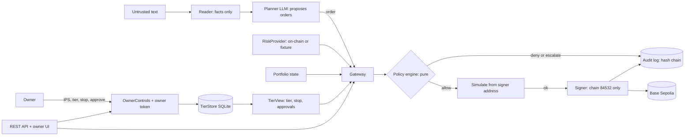
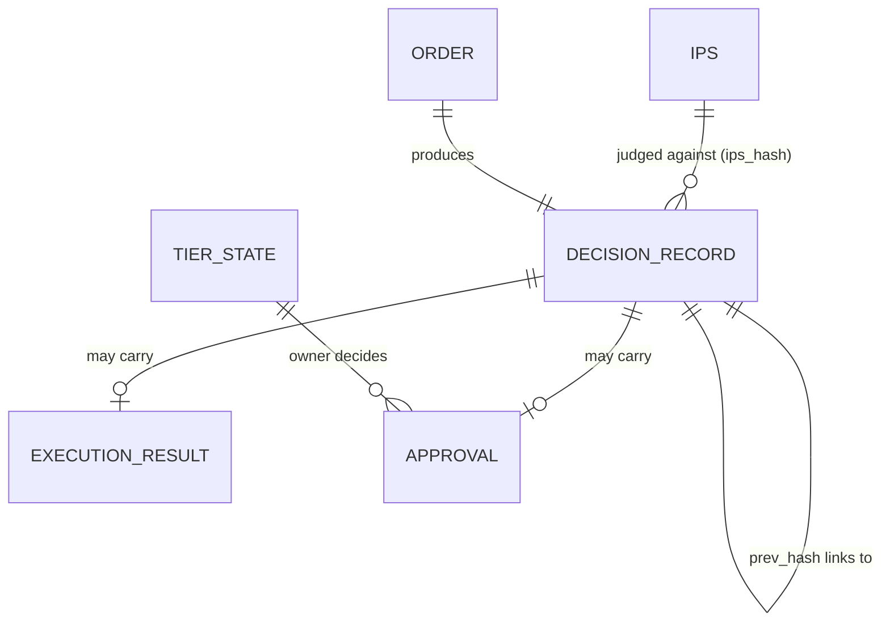

# Technical documentation

Competition deliverable 01: system architecture, core algorithm description, security design. Detail lives in the notes under `docs/architecture/`; this page is the map and the argument.

## 1. What the system does
BaKhi Wallet (team BaKhi) is an AI wallet agent that manages a small on-chain portfolio on Base Sepolia (testnet) inside limits the owner wrote down as an **Investment Policy Statement (IPS)**. The language model proposes orders. A deterministic policy engine, not the model, decides each one. Only the gateway can reach the signer. Every decision, including each refusal and its reason, is written to a hash-chained log that anyone can verify.

Design claim: *the agent can only do what the IPS allows, and anything it does is provable afterwards.*

## 2. System architecture



| Layer | Package | Responsibility | Note |
| :--- | :--- | :--- | :--- |
| Contracts | `contracts/` | JSON Schemas, OpenAPI, 31 rule codes, IPS presets, examples | [`contracts.md`](../architecture/core/contracts.md) |
| Agent | `core/agent` | Reader (untrusted text to structured facts), Planner (facts to orders), LLM client | [`planner-reader.md`](../architecture/agent/planner-reader.md) |
| Policy | `core/policy` | IPS loader (immutable, hashed), pure rule engine | [`ips-loader.md`](../architecture/core/ips-loader.md), [`policy-engine.md`](../architecture/core/policy-engine.md) |
| Gateway | `core/gateway` | propose, tier gate, policy, simulate, sign, record; idempotency | [`gateway.md`](../architecture/core/gateway.md), [`gateway-wiring.md`](../architecture/core/gateway-wiring.md) |
| Signer | `core/signer` | Local key, signs only chain 84532, never imported outside the gateway | [`signer.md`](../architecture/core/signer.md) |
| Protocols | `core/protocols` | One registry: each protocol is a spec with its calldata builder, spenders, positions and plain-English description. Aave v3 (USDC, USDT), Aave stata ERC-4626 vaults, Morpho Blue (two allow-listed markets), Uniswap v3 swaps with a quote-based minimum output and oracle price guard | [`protocols.md`](../architecture/protocols/protocols.md), [`aave-adapter.md`](../architecture/protocols/aave-adapter.md), [`aave-stata.md`](../architecture/protocols/aave-stata.md), [`morpho-blue.md`](../architecture/protocols/morpho-blue.md), [`uniswap-v3.md`](../architecture/protocols/uniswap-v3.md) |
| Risk | `core/risk` | Risk inputs by protocol and market, read from chain (Aave reserves, Morpho markets, Uniswap pools), fail closed, each field labelled on-chain or reference; offline fixtures for tests | [`risk-inputs.md`](../architecture/agent/risk-inputs.md) |
| Tiers | `core/tiers` | Persistent tier, emergency stop, approval queue; read-only view vs owner controls | [`tiers.md`](../architecture/core/tiers.md) |
| Audit | `core/audit` | Append-only SQLite hash chain, verifier, JSONL export | [`audit-log.md`](../architecture/core/audit-log.md) |
| Interface | `api`, `ui` | REST API from the OpenAPI contract; web app with chat as home, portfolio, activity, rules, owner sign-in, step-up signatures | [`api.md`](../architecture/webapp/api.md), [`ui.md`](../architecture/webapp/ui.md), [`webapp.md`](../architecture/webapp/webapp.md) |
| Hosting and storage | `core/storage`, `Dockerfile` | Multi-owner mode: per-owner agent wallet, encrypted keystore, Postgres (row level security) or SQLite, jobs, chat threads | [`custody-tenancy.md`](../architecture/webapp/custody-tenancy.md), [`storage.md`](../architecture/webapp/storage.md), [`deployment.md`](../guides/deployment.md) |
| Evaluation | `evals` | Offline replay harness, 46 scenarios, 27 of the 28 codes in the evaluation report (the 28th, `TIER.POLICY_CHANGED`, is a status; three newer codes are not yet part of the report), report | [`evals.md`](../architecture/agent/evals.md) |

### 2b. Hosted web app, protocol registry and trust boundary

```mermaid
flowchart LR
  subgraph Owner side
    W[Owner wallet: signs in and approves widening actions]
    UI[Web app: chat, portfolio, activity, rules]
  end
  subgraph Server: Render, Postgres on Supabase
    API[API: session from a signed message, CSRF, step-up]
    JOBS[Jobs: one active per owner, hourly limit, cancel]
    PL[Planner LLM: enums only]
    GW[Gateway: tier, policy, simulate, sign, record]
    REG[(Protocol registry: spenders, calldata, positions)]
    KS[(Keystore: encrypted agent key per owner)]
    AUD[(Audit chain, RLS per owner)]
  end
  W -->|signature| API
  UI --> API --> JOBS --> PL --> GW
  REG --> GW
  GW --> KS
  GW -->|signed tx| CH[(Base Sepolia)]
  GW --> AUD
```

- **Trust boundary today.** The owner keeps the rules and the kill switch: tier, preset, approvals and releasing a stop need a fresh owner signature bound to that action and its parameters. The server holds the agent's key (generated server-side, encrypted at rest, never returned by a route) and can only use it through the gateway, which enforces the owner's IPS. A compromised server could sign anything its keys allow, so the keys hold testnet value only. This is stated on every page and in known risks K7 and K13.
- **Path to mainnet (out of scope for this submission).** Replace the server-held key with a smart account whose session key is limited by the same policy (ERC-4337 or a comparable account standard), or with threshold signing, so the server can no longer sign outside the owner's limits even if compromised. The policy engine, tiers, registry and audit log stay unchanged; only the signer behind the gateway changes.
- **Protocol registry.** A protocol is a spec registered in code (`core/protocols/registry.py`): the order carries enums and amounts only, never an address. Spenders, targets, fee tiers and market parameters live in the spec; the gateway re-checks that the protocol and market are enabled after the policy decision (`ACCESS.PROTOCOL_NOT_ENABLED`, `ACCESS.MARKET_NOT_ALLOWED`) and the IPS universe must list the protocol. Presets (`conservative`, `diversified`) are files under `contracts/presets/`; choosing one needs an owner signature bound to the preset.
- **Valuation.** Every USD figure goes through one function over a token registry; a token without a readable price is denied, never valued at zero. Swaps compute the minimum output from the executable pool quote minus slippage, with a guard refusing pools more than 3% worse than the oracle fair value.

## 3. Core algorithm: one order, end to end
`Gateway.propose(order)`:

1. **Validate** the order against `order.schema.json`. Anything else is rejected before any rule runs.
2. **Idempotency**: the same `order_id` with the same body returns the stored record; a different body raises `OrderIdConflict`. An order never executes twice.
3. **Tier gate**: read tier and emergency stop from `TierView`. Stop engaged, tier T0 or T1, or an unreadable state denies immediately (`TIER.EMERGENCY_STOP`, `TIER.READ_ONLY`, `TIER.PROPOSE_ONLY`). Nothing after this point runs.
4. **Policy engine** (`evaluate`, pure): checks every rule and returns *all* violated rules, not just the first.
   - ACCESS: token, protocol, function, recipient in the IPS universe; exact-amount allowance only.
   - LIMIT: per transaction, per 24 h, transactions per hour.
   - ALLOC: weight per asset, minimum stable weight, rebalance band (inside the band means `no_action`).
   - RISK: pool TVL, reward share of APY, APY stability, depeg, utilization, slippage, cost against benefit, data freshness. Missing or incomplete risk inputs deny with `RISK.DATA_STALE`.
   - Result is one of `allow`, `deny`, `escalate` (above `approval.escalate_above_usd`) or `no_action`.
5. **Escalate**: the order is queued as `pending_approval`; only the owner can approve. The policy is evaluated again when the order returns, so an approval cannot turn a `deny` into an execution.
6. **Simulate before sign**: the calls are simulated as the signer's own address with `eth_simulateV1`; dependent calls (approve then supply) are simulated as one bundle. Failure, or a simulator that cannot do bundles, means nothing is signed.
7. **Sign and send** with the signer, which refuses any chain id other than 84532.
8. **Record**: a `DecisionRecord` (order, decision, rules hit with evidence, execution, approval, tier, IPS hash) is appended to the audit chain.

Why this ordering: the cheap and the most restrictive checks run first, the signer is the last step, and the record is written for every outcome, so a denial is as visible as an execution.

### Audit chain
Each record carries `prev_hash` and `hash = SHA-256(canonical JSON of the record without hash)`, where canonical JSON has sorted keys, compact separators and UTF-8. The genesis `prev_hash` is 64 zeros. Editing, deleting or reordering any record breaks the chain at a known `seq`. SQLite triggers reject UPDATE and DELETE, and writers use `BEGIN IMMEDIATE`, so two processes cannot fork the chain.

### Prompt-injection posture
The Reader converts untrusted text to a closed, schema-bound facts object; free text never reaches the Planner as instructions. The Planner's output must validate against the order schema, and even a perfectly valid order proposed under attack is still judged by the policy engine against the owner's universe. The model has no key and no tool that signs.

## 4. Security design
Summarised here, argued in full in [`security/self-assessment.md`](05-security-self-assessment.md):

- **Least authority**: `TierView` (read) and `OwnerControls` (write) are separate objects; agent-facing packages cannot import the latter (AST test).
- **Single path to the signer**: only `core.gateway` imports `core.signer` (test + CI).
- **Fail closed**: missing data, unreadable tier, unset owner token, unsupported simulation all deny.
- **Testnet containment**: chain id check in the signer; testnet addresses only.
- **Secrets**: `.env` ignored, names only in `.env.example`, secret scan in CI.
- **Evidence over claims**: every control names its test; the eval harness exercises 27 of the 28 codes in the evaluation report (the 28th, `TIER.POLICY_CHANGED`, is a status; three newer codes are not yet part of the report).

## 5. Data model

Field-level contracts: `contracts/schemas/*.schema.json`; HTTP surface: `contracts/openapi.yaml`.

## 6. Verification and reproduction
See `README.md` (quick start) and section 5 of the self-assessment. In short:

```sh
python -m pytest -q          # full suite
python -m evals.run          # 46 offline scenarios, writes docs/evidence/eval-report.md
python -m core.audit.verify docs/evidence/audit-chain.jsonl
```
Live evidence on Base Sepolia: `docs/evidence/tx_hashes.md`.

## 7. Limits of this version
Reference prices (not market prices), a single RPC endpoint, custodial testnet keys without an HSM (see 2b for the mainnet path), and testnet protocol quirks: Morpho markets are user-created with constant oracles, the Aave oracle is admin-set, and a Uniswap pool can be mispriced. Risk inputs without a testnet source (reward share, APY deviation, cross-exchange depeg) stay labelled reference (K5, K21). Job cancellation state is in-process, correct for the single instance we run (K23). The status and plan for each are in the known-risk list.
