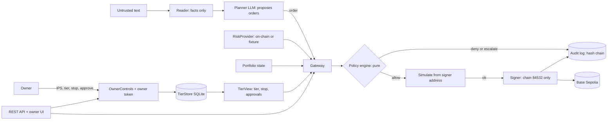
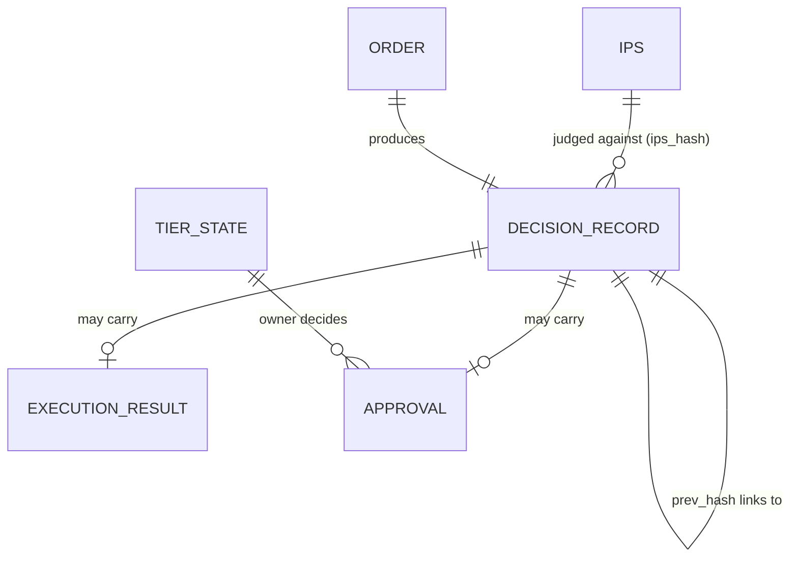

# Technical documentation

Competition deliverable 01: system architecture, core algorithm description, security design. Detail lives in the notes under `docs/architecture/`; this page is the map and the argument.

## 1. What the system does
agent-wallet is an AI wallet agent that manages a small on-chain portfolio on Base Sepolia (testnet) inside limits the owner wrote down as an **Investment Policy Statement (IPS)**. The language model proposes orders. A deterministic policy engine, not the model, decides each one. Only the gateway can reach the signer. Every decision, including each refusal and its reason, is written to a hash-chained log that anyone can verify.

Design claim: *the agent can only do what the IPS allows, and anything it does is provable afterwards.*

## 2. System architecture



| Layer | Package | Responsibility | Note |
| :--- | :--- | :--- | :--- |
| Contracts | `contracts/` | JSON Schemas, OpenAPI, 25 rule codes, examples | [`contracts.md`](architecture/contracts.md) |
| Agent | `core/agent` | Reader (untrusted text to structured facts), Planner (facts to orders), LLM client | [`planner-reader.md`](architecture/planner-reader.md) |
| Policy | `core/policy` | IPS loader (immutable, hashed), pure rule engine | [`ips-loader.md`](architecture/ips-loader.md), [`policy-engine.md`](architecture/policy-engine.md) |
| Gateway | `core/gateway` | propose, tier gate, policy, simulate, sign, record; idempotency | [`gateway.md`](architecture/gateway.md), [`gateway-wiring.md`](architecture/gateway-wiring.md) |
| Signer | `core/signer` | Local key, signs only chain 84532, never imported outside the gateway | [`signer.md`](architecture/signer.md) |
| Protocols | `core/protocols` | Aave V3 calldata builders with exact-amount approvals | [`aave-adapter.md`](architecture/aave-adapter.md) |
| Risk | `core/risk` | Risk-input provider: on-chain Aave data, offline fixtures | [`risk-inputs.md`](architecture/risk-inputs.md) |
| Tiers | `core/tiers` | Persistent tier, emergency stop, approval queue; read-only view vs owner controls | [`tiers.md`](architecture/tiers.md) |
| Audit | `core/audit` | Append-only SQLite hash chain, verifier, JSONL export | [`audit-log.md`](architecture/audit-log.md) |
| Interface | `api`, `ui` | REST API from the OpenAPI contract, minimal owner console | [`api.md`](architecture/api.md), [`ui.md`](architecture/ui.md) |
| Evaluation | `evals` | Offline replay harness, 44 scenarios, report | [`evals.md`](architecture/evals.md) |

## 3. Core algorithm: one order, end to end
`Gateway.propose(order)`:

1. **Validate** the order against `order.schema.json`. Anything else is rejected before any rule runs.
2. **Idempotency**: the same `order_id` with the same body returns the stored record; a different body raises `OrderIdConflict`. An order never executes twice.
3. **Tier gate**: read tier and emergency stop from `TierView`. Stop engaged, tier T0 or T1, or an unreadable state denies immediately (`TIER.EMERGENCY_STOP`, `TIER.READ_ONLY`, `TIER.PROPOSE_ONLY`). Nothing after this point runs.
4. **Policy engine** (`evaluate`, pure): checks every rule and returns *all* violated rules, not just the first.
   - ACCESS: token, protocol, function, recipient in the IPS universe; exact-amount allowance only.
   - LIMIT: per transaction, per 24 h, transactions per hour.
   - ALLOC: weight per asset, minimum stable weight, rebalance band (inside the band means `no_action`).
   - RISK: pool TVL, reward share of APY, APY stability, depeg, utilization, slippage, cost against benefit, data freshness. Missing or incomplete risk inputs deny with `RISK.DATA_STALE`.
   - Result is one of `allow`, `deny`, `escalate` (above `approval.escalate_above_usd`) or `no_action`.
5. **Escalate**: the order is queued as `pending_approval`; only the owner can approve. The policy is evaluated again when the order returns, so an approval cannot turn a `deny` into an execution.
6. **Simulate before sign**: the calls are simulated as the signer's own address with `eth_simulateV1`; dependent calls (approve then supply) are simulated as one bundle. Failure, or a simulator that cannot do bundles, means nothing is signed.
7. **Sign and send** with the signer, which refuses any chain id other than 84532.
8. **Record**: a `DecisionRecord` (order, decision, rules hit with evidence, execution, approval, tier, IPS hash) is appended to the audit chain.

Why this ordering: the cheap and the most restrictive checks run first, the signer is the last step, and the record is written for every outcome, so a denial is as visible as an execution.

### Audit chain
Each record carries `prev_hash` and `hash = SHA-256(canonical JSON of the record without hash)`, where canonical JSON has sorted keys, compact separators and UTF-8. The genesis `prev_hash` is 64 zeros. Editing, deleting or reordering any record breaks the chain at a known `seq`. SQLite triggers reject UPDATE and DELETE, and writers use `BEGIN IMMEDIATE`, so two processes cannot fork the chain.

### Prompt-injection posture
The Reader converts untrusted text to a closed, schema-bound facts object; free text never reaches the Planner as instructions. The Planner's output must validate against the order schema, and even a perfectly valid order proposed under attack is still judged by the policy engine against the owner's universe. The model has no key and no tool that signs.

## 4. Security design
Summarised here, argued in full in [`security/self-assessment.md`](security/self-assessment.md):

- **Least authority**: `TierView` (read) and `OwnerControls` (write) are separate objects; agent-facing packages cannot import the latter (AST test).
- **Single path to the signer**: only `core.gateway` imports `core.signer` (test + CI).
- **Fail closed**: missing data, unreadable tier, unset owner token, unsupported simulation all deny.
- **Testnet containment**: chain id check in the signer; testnet addresses only.
- **Secrets**: `.env` ignored, names only in `.env.example`, secret scan in CI.
- **Evidence over claims**: every control names its test; the eval harness exercises 25/25 rule codes.

## 5. Data model

Field-level contracts: `contracts/schemas/*.schema.json`; HTTP surface: `contracts/openapi.yaml`.

## 6. Verification and reproduction
See `README.md` (quick start) and section 5 of the self-assessment. In short:

```sh
python -m pytest -q          # full suite
python -m evals.run          # 44 offline scenarios, writes docs/evidence/eval-report.md
python -m core.audit.verify docs/evidence/audit-chain.jsonl
```
Live evidence on Base Sepolia: `docs/evidence/tx_hashes.md`.

## 7. Limits of this version
Reference prices (not market prices), a single RPC endpoint, a local testnet key without HSM, and, until the runner tickets land, in-memory idempotency and caller-supplied hourly and daily counters. The status and plan for each are in the known-risk list.
